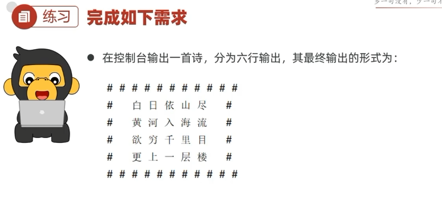
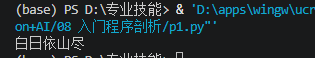

# 08 入门程序剖析
## 1. .idea .venv
.idea保存项目的配置信息
.venv:虚拟环境,保存项目的环境信息,当前项目运行所依赖的环境,相互不会影响
## 2.布置了一个练习

```python
print("白日" \
"依山尽")
```

\ 说明本行代码未完成，下一行继续

```
print("# # # # # # # # # # #")
print("#  白 日 依 山 尽   #")
print("#  黄 河 入 海 流   #")
print("#  欲 穷 千 里 目   #")
print("#  更 上 一 层 楼   #")
print("# # # # # # # # # # #")

print("""# # # # # # # # # # #
#   白 日 依 山 尽  #
#   黄 河 入 海 流  #
#   欲 穷 千 里 目  #
#   更 上 一 层 楼  #
# # # # # # # # # # #""")
```

两个解法
"""可以包含住里面所有的输出内容