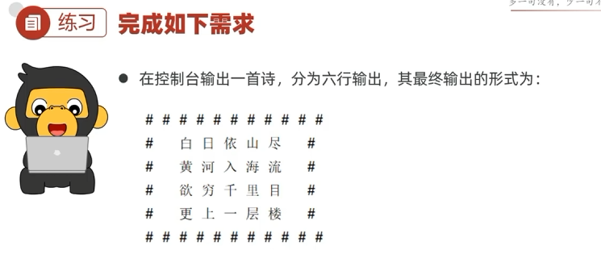
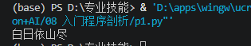

# 第08课：项目环境、字符串续行与多行输出

> 本次整理日期：2026-11-14（北京时间）；历史资料补齐，原学习日期未确认。来源为本课同目录原笔记、代码和配图。

> 基于 [原笔记](note.md) 整理，配套代码：[p1.py](p1.py)。下面的代码片段是便于对比的独立示例，原脚本保持不变；新增解释标注为「补充」。

> 排版调整：2026-11-14（北京时间）。以原笔记顺序为主线，图文和补充就近组织；沿用原有转写与验证记录，本次未修改原始材料或重新执行程序。

## 1. .idea .venv

.idea保存项目的配置信息
.venv:虚拟环境,保存项目的环境信息,当前项目运行所依赖的环境,相互不会影响

### 补充：本课目标

- 分清 `.idea` 与 `.venv` 的作用。
- 理解代码续行为什么不一定让输出换行。
- 用多个 `print()` 或三引号完成诗歌输出练习。

### 补充：.idea 与 .venv

| 项目 | 作用 | 本次学习如何理解 |
| --- | --- | --- |
| `.idea` | PyCharm 等 JetBrains 工具保存项目设置的目录 | 属于开发工具的项目配置，不是 Python 解释器或第三方库 |
| `.venv` | 常见的项目虚拟环境目录 | 保存环境配置、解释器相关文件和该环境安装的包，主要用于隔离项目依赖 |

**补充：**VS Code 项目没有 `.idea` 很正常；`.venv` 也需要创建后才会出现，不是安装编辑器就一定自动生成。

虚拟环境通常基于已有的 Python 创建。例如用 Python 3.13.9 创建的 venv，使用的也是这一版本，不会自动替你下载另一个版本。“隔离”主要指 Python 包依赖，并不表示把电脑上的文件和网络完全隔离。环境用法参见 [Python venv 文档](https://docs.python.org/3.13/library/venv.html)。

## 2.布置了一个练习



**图片文字版：**本课要求分六行输出上下井号边框与《登鹳雀楼》四句。完整文字可对照本图附近的诗歌代码。

**方法一：每行调用一次 print()。**

```python
print("# # # # # # # # # # #")
print("#  白 日 依 山 尽   #")
print("#  黄 河 入 海 流   #")
print("#  欲 穷 千 里 目   #")
print("#  更 上 一 层 楼   #")
print("# # # # # # # # # # #")
```

**方法二：用三引号保存整段多行字符串。**

```python
print("""# # # # # # # # # # #
#  白 日 依 山 尽   #
#  黄 河 入 海 流   #
#  欲 穷 千 里 目   #
#  更 上 一 层 楼   #
# # # # # # # # # # #""")
```

两个独立示例的预期输出完全相同：

```text
# # # # # # # # # # #
#  白 日 依 山 尽   #
#  黄 河 入 海 流   #
#  欲 穷 千 里 目   #
#  更 上 一 层 楼   #
# # # # # # # # # # #
```

- 三引号是开头、结尾各连续三个英文引号：`"""`。
- 为了不增加开头和结尾的空白行，第一行文字紧接开头三引号，结尾三引号紧接最后一行。
- `#` 在字符串中是普通文字，不是 Python 注释。
- 三引号会保留内部的换行与空格；中文边框能否视觉对齐还受终端字体与字符显示宽度影响。

```python
print("白日" \
"依山尽")
```



**图片文字版：**运行截图显示 PowerShell 执行后的单行结果“白日依山尽”；命令路径有裁切，不能据此复原完整运行路径。

**补充：**编辑器有时会在字符串内按回车时自动补引号和反斜杠；具体行为取决于编辑器或扩展。自动生成的下面这段代码本身合法：

```python
print("" \
      "")
```

输出：**一个空行**，因为两个空字符串拼接后仍是空字符串，`print()` 默认在末尾换行。

### 补充：代码续行与输出换行

| 写法或现象 | 发生在哪里 | 会让输出文字换行吗？ |
| --- | --- | --- |
| 行尾反斜杠 `\` | 字符串之外，连接两行源代码 | 不会自动产生输出换行 |
| 括号内把代码写成多行 | 源代码 | 不会仅因为代码分行就让输出换行 |
| 字符串中的 `\n` | 字符串内容 | 用 `print()` 输出时会产生换行 |
| 三引号字符串中的实际回车 | 字符串内容 | 回车会保留在字符串中，输出时会分行 |
| 多次调用 `print()` | 程序执行过程 | 默认每次调用结束后换行 |

**关键区别：代码如何排版，与字符串里有没有换行，是两件事。** 规则参见 [Python 显式续行](https://docs.python.org/3.13/reference/lexical_analysis.html#explicit-line-joining)、[字符串字面量](https://docs.python.org/3.13/reference/lexical_analysis.html#string-and-bytes-literals)。

### 补充：相邻字符串字面量会自动拼接

```python
print("白日" \
      "依山尽")
```

输出：

```text
白日依山尽
```

这里有两个机制：

- `\` 把两行源代码连接起来。
- `"白日"` 和 `"依山尽"` 是相邻的字符串字面量，会拼成一个字符串。

因此，直接把 `\` 理解成“让输出换行”是不对的。

原运行截图也展示了它仍输出在一行：

### 补充：括号内也可以直接分行

```python
print(
    "白日"
    "依山尽"
)
```

输出仍是：

```text
白日依山尽
```

这里不需要行尾反斜杠，因为圆括号内允许隐式续行；相邻字符串字面量仍然会拼接。

### 补充：用 \n 控制输出换行

```python
print("白日依山尽\n黄河入海流")
```

输出：

```text
白日依山尽
黄河入海流
```

`\n` 要写在字符串中，由反斜杠和字母 `n` 组成。`\#` 不是换行符，也不需要用它来输出井号。

\ 说明本行代码未完成，下一行继续

```
print("# # # # # # # # # # #")
print("#  白 日 依 山 尽   #")
print("#  黄 河 入 海 流   #")
print("#  欲 穷 千 里 目   #")
print("#  更 上 一 层 楼   #")
print("# # # # # # # # # # #")

print("""# # # # # # # # # # #
#   白 日 依 山 尽  #
#   黄 河 入 海 流  #
#   欲 穷 千 里 目  #
#   更 上 一 层 楼  #
# # # # # # # # # # #""")
```

## 两个解法

"""可以包含住里面所有的输出内容

### 补充：诗歌练习：两种解法

课程要求：在控制台分六行输出带 `#` 边框的诗歌。

### 补充：运行原有 p1.py 时会看到什么

**运行位置：VS Code 的 PowerShell 终端。**

```powershell
cd "D:\专业技能\learning-journey\python\黑马python+AI\p0\08 入门程序剖析"
python .\p1.py
```

原脚本包含续行示例和两个诗歌解法，所以会依次输出一行 `白日依山尽`，再输出两遍诗歌。原脚本两种解法的空格数量略有差异；上面的优化示例已经统一空格，但没有修改原 `p1.py`。

### 补充：易错点

| 容易混淆 | 正确理解 |
| --- | --- |
| “有 .venv，所有资源就相互隔离” | venv 主要隔离 Python 包依赖，不等同于独立电脑 |
| “行尾加 `\`，文字就会换行” | 它连接源代码行，输出换行需由字符串内容或输出操作决定 |
| 用 `\#` 输出井号 | 直接把 `#` 写进字符串即可 |
| 每行都手动补一对引号，以为会输出多行 | 相邻字符串可能被拼接，输出不一定分行 |
| 把三引号字符串统一当成“多行注释” | 它首先是字符串；在 `print()` 中会被输出，并非注释语法 |

**补充提醒：**使用显式续行时，反斜杠后不要再写空格、文字或注释；它应处在源代码行的最后。

### 补充：本课代码检查结论

**命名、表达和效率：**当前可执行代码没有自定义变量，无需强行改名；未发现需要修复的语法或逻辑问题。print与引号拼写正常，无内置名称遮蔽。多个输出示例保留作教学比较；固定少量输出无值得提速的瓶颈，没有做性能基准。

## 5. 自测与答案

1. **`print("白日" \` 后接下一行 `"依山尽")`，为什么只输出一行？**  
   反斜杠只是连接代码行，相邻字符串字面量会拼接，内容中没有换行符。

2. **两种诗歌解法怎样保证输出一致？**  
   让每行文字和空格完全相同，并避免三引号额外引入首尾空白行；两种写法的 `print()` 都会默认在末尾换行。

## 6. 本次优化与资料

- 将 `.idea` 与 `.venv` 分开解释，收窄“互不影响”的含义。
- 补全续行示例的实际输出，并标明空字符串示例本身合法。
- **补充：**括号内续行、`\n`、三引号首尾空行等对比，统一两个诗歌示例的输出。
- 保留原截图和脚本，并说明原脚本连续输出三个示例的行为。
- 官方资料：[PyCharm 项目设置](https://www.jetbrains.com/help/pycharm/project-and-ide-settings.html)、[Python venv](https://docs.python.org/3.13/library/venv.html)、[字符串字面量拼接](https://docs.python.org/3.13/reference/lexical_analysis.html#string-literal-concatenation)。

## 附：既有源码与核验记录 / 当前源文件：p1.py

```python
print("白日" \
"依山尽")
print("# # # # # # # # # # #")
print("#  白 日 依 山 尽   #")
print("#  黄 河 入 海 流   #")
print("#  欲 穷 千 里 目   #")
print("#  更 上 一 层 楼   #")
print("# # # # # # # # # # #")

print("""# # # # # # # # # # #
#   白 日 依 山 尽  #
#   黄 河 入 海 流  #
#   欲 穷 千 里 目  #
#   更 上 一 层 楼  #
# # # # # # # # # # #""")
```

使用内存执行实际核验，输出如下；未修改原文件：

```text
白日依山尽
# # # # # # # # # # #
#  白 日 依 山 尽   #
#  黄 河 入 海 流   #
#  欲 穷 千 里 目   #
#  更 上 一 层 楼   #
# # # # # # # # # # #
# # # # # # # # # # #
#   白 日 依 山 尽  #
#   黄 河 入 海 流  #
#   欲 穷 千 里 目  #
#   更 上 一 层 楼  #
# # # # # # # # # # #
```

**命名、表达和效率：**当前可执行代码没有自定义变量，无需强行改名；未发现需要修复的语法或逻辑问题。print与引号拼写正常，无内置名称遮蔽。多个输出示例保留作教学比较；固定少量输出无值得提速的瓶颈，没有做性能基准。
