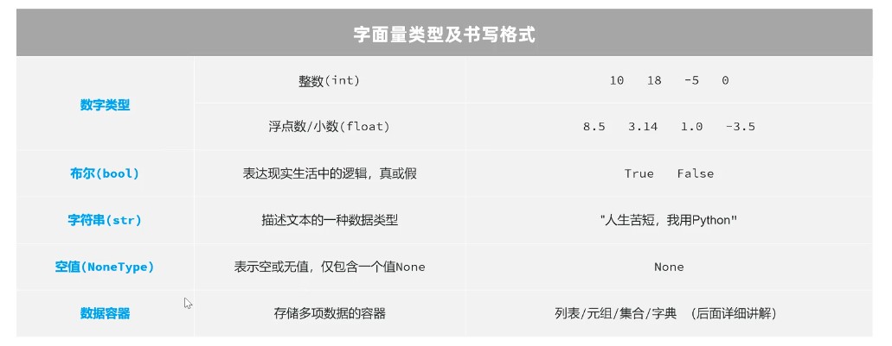
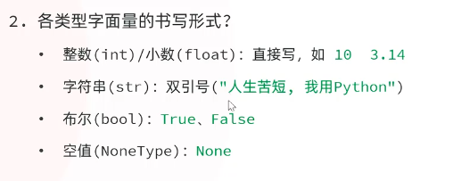

# 第09课：字面量、常见类型与布尔值

> 原笔记：[09.md](09.md)；配套代码：[字面量与变量.py](字面量与变量.py)。  
> 本次整理日期：2026-11-13（北京时间）。历史资料补齐，原学习日期未确认。原始文件保留，新增解释属于补充。

> 排版调整：2026-11-14（北京时间）。以原笔记顺序为主线，图文和补充就近组织；沿用原有转写与验证记录，本次未修改原始材料或重新执行程序。

字面量（固定值，数据）：怎么写
变量：怎么存

### 补充：本课目标

- 认识直接写在代码里的整数、小数、字符串、布尔值与空值。
- 分清字符串边界、显示结果和数据类型。
- 理解布尔值参与简单算术运算时的表现。

## 字面量种类和书写格式



**图片 `image.png` 的文字表格：**

| 分类 | 类型或说明 | 图片中的示例 |
| --- | --- | --- |
| 数字类型 | 整数 `int` | `10`、`18`、`-5`、`0` |
| 数字类型 | 浮点数／小数 `float` | `8.5`、`3.14`、`1.0`、`-3.5` |
| 布尔 `bool` | 表达现实生活中的逻辑：真或假 | `True`、`False` |
| 字符串 `str` | 描述文本的一种数据类型 | `"人生苦短，我用Python"` |
| 空值 `NoneType` | 表示空或无值，仅包含一个值 `None` | `None` |
| 数据容器 | 存储多项数据的容器 | 列表、元组、集合、字典，后面详细讲解 |

**补充：**最后一行是容器类别的课程预告，并非一个统一的具体类型名；本课先认识即可。



**图片 `image-1.png` 的文字版——各类型字面量的书写形式：**

- 整数 `int`、小数 `float`：直接写，如 `10`、`3.14`。
- 字符串 `str`：图中使用双引号，如 `"人生苦短，我用Python"`。
- 布尔 `bool`：`True`、`False`。
- 空值 `NoneType`：`None`。

**补充：**图中只展示了双引号形式，Python 同样支持前后匹配的单引号字符串。

### 补充：核心知识

字面量可以先理解为直接写在代码里的值。例如 `100`、`3.14`、`"Hello World"`。变量则是用于引用值的名称，下一课会学习赋值。

| 写法 | 类型 | 注意点 |
| --- | --- | --- |
| `100` | `int`，整数 | 不需要引号 |
| `3.14` | `float`，浮点数 | 常用来表示小数 |
| `True`、`False` | `bool`，布尔值 | 首字母必须大写 |
| `"Hello World"`、`'Hello World'` | `str`，字符串 | 单双引号都可以，前后应匹配 |
| `None` | `NoneType` | 常表示没有值，不等于数字 `0` 或空字符串 |

**纠正：**原笔记中的 `Flase` 是拼写错误，正确写法是 `False`。`"100"` 是字符串，`100` 是整数；输出看起来相似，类型和能做的操作却不同。

### 补充：配套代码与实际输出

配套代码依次输出不同类型的值，再计算 `True + 1` 与 `False - 1`。已运行原脚本验证，输出为：

```text
100
3.14
True
False
Hello World
------------------
None
2
-1
```

`print()` 默认在每次调用结束后换行。字符串两侧的引号用于表示代码里的字符串边界，通常不会作为字符串内容输出。

**补充：**Python 中 `bool` 是 `int` 的子类。参与这里的算术运算时，`True` 按 `1`、`False` 按 `0` 参与计算，所以结果分别是 `2` 与 `-1`。这不表示布尔值与整数在所有场景中都应混用；表达真假状态时仍优先使用 `True`、`False`。

### 补充：当前代码可优化的点

- **可读性改进：**行内注释前留出至少两个空格，例如 `print(100)  # 整数（int）`。
- **注释更准确：**把“布尔类型本质也是整数类型”细化为“`bool` 是 `int` 的子类；本例算术运算中按 1 和 0 计算”，避免把“真假状态”完全等同于普通数值。
- 当前脚本作为类型展示练习已经足够简洁，不需要封装函数。以上为建议，原代码未修改。

行内注释排版的对照示例（建议写法）：

```python
print(100)  # 整数（int）
print(3.14)  # 浮点数（float）
print(True + 1)  # 本例中 True 按 1 参与计算，结果为 2
```

### 补充：易错点与自测

- `true`、`false` 与 `True`、`False` 不相同；前两者不是内置布尔常量。
- `None` 不需要引号；`"None"` 是包含四个字符的字符串。
- 想知道类型时可以用 `type()`，不只观察打印出来的样子。

补充自测，以下是独立示例：

```python
print(type(100))
print(type("100"))
```

预期输出（根据代码推导）：

```text
<class 'int'>
<class 'str'>
```

### 补充：英文命名、语句与效率专项检查

- **英文命名：**当前可执行代码没有用户自定义变量；内置名称与类型注释中的英文未发现拼写问题。布尔值必须使用正确大小写的 True、False。
- **语句表达：**保持逐条输出便于对比不同类型，主要按前文整理注释与空格。
- **效率：**固定数量的演示输出，没有值得专门优化的性能问题。减少演示项会改变学习内容；排版变化不等于提速。

也可以使用单引号
涉及数学运算True转化为1，False转化为0

## 附：完整源码备查（沿用原稿版本）

以下按原文件收录，包含注释掉的练习。带 `#` 的行不会执行；这些代码与前面的建议改写分开，原 `.py` 文件没有修改。

### 字面量与变量.py

```python
# 字面量的写法
print(100)# 整数（int）
print(3.14)# 浮点数/小数（float）
print(True)# 必须大写 布尔（bool）
print(False)# 必须大写 布尔（bool）
print("Hello World")# 字符串（str）
print("------------------")# ''也可以 字符串（str）
print(None)# 空值（NoneType） 代表没有值

# 布尔类型本质也是整数类型（True = 1, False = 0）
print(True + 1) # 2
print(False - 1) # -1
```
