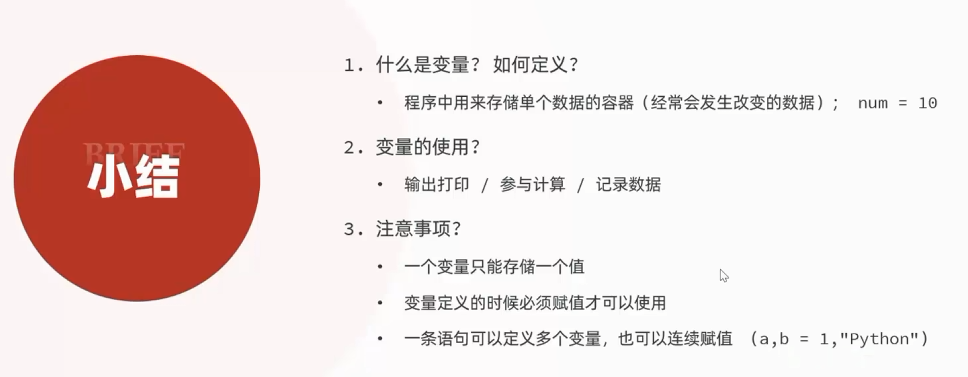

# 第10课：变量、赋值与播放量练习

> 原笔记：[10.md](10.md)；配套代码：[字面量与变量.py](字面量与变量.py)。  
> 本次整理日期：2026-11-13（北京时间）。历史资料补齐，原学习日期未确认。原始文件保留，新增解释属于补充。

> 排版调整：2026-11-14（北京时间）。以原笔记顺序为主线，图文和补充就近组织；沿用原有转写与验证记录，本次未修改原始材料或重新执行程序。

存储单个数据的容器（而不是数据），存容易变化的数据
定义格式： 变量名 = 变量的值；  num = 1114.1
                =：赋值，把右边的值赋给左边变量
python是动态类型语言，运行时才类型检查，类型在运行时可以改变（一个变量可以接收不同类型的值）
实际项目尽量让同一名称保持清楚、稳定的含义与预期类型。

### 补充：本课目标

- 理解变量名称与值的关系，以及 `=` 的赋值含义。
- 看懂重新赋值与一次给多个名称赋值。
- 解释当前播放量练习为什么会输出两组相同结果。

### 补充：变量与赋值

把变量理解为“存数据的容器”有助于入门。更准确地说，Python 中变量名称绑定到对象；赋值让左侧名称引用右侧表达式计算得到的对象。

```python
num = 1114.1
num = num + 1
```

第二行先读取当前 `num` 的值，计算 `num + 1`，再把结果赋给 `num`。这里的 `=` 是赋值，不是数学中的相等关系；比较相等通常使用 `==`。

**补充：**对象有类型，名称可以在不同时间绑定不同类型的对象。例如先写 `num = 1`，再写 `num = "OK"` 是合法的。这并不是原来的整数对象变成字符串。实际项目中，同一名称尽量保持一致的含义和预期类型，便于理解代码。

## 案例


**图片 `image.png` 的文字版——播放量题目：**

| 已知条件或要求 | 内容 |
| --- | --- |
| 课程基础播放量 | `20.7` 万 |
| 每月新增播放量 | `50` 万 |
| 要求 | 输出未来两个月各个月的播放总量 |

因此，本课数值单位应理解为“万”，结果 `70.7`、`120.7` 分别表示 `70.7` 万和 `120.7` 万。

课程小结配图与对应转写保留在后面的“小结”处。

### 补充：读懂当前播放量练习

当前脚本使用：

```python
base = 20.7
incr = 50
print("未来第一个月总播放量：", base + incr)
print("未来第二个月总播放量：", base + 2 * incr)
```

- `base`：基础播放量；根据题目图片，单位是“万”。
- `incr`：每个月的新增播放量，本例假设每个月增加量相同。
- `base + 2 * incr`：先做乘法，再做加法，表示增加两个月后的结果。

后面又写了 `base, incr = 20.7, 50`，分别把右侧两个值赋给左侧两个名称，并再次输出。它是另一种赋值写法，不是同时建立一个名为 `base, incr` 的变量。

已运行原脚本验证，完整输出为：

```text
未来第一个月总播放量： 70.7
未来第二个月总播放量： 120.7
未来第一个月总播放量： 70.7
未来第二个月总播放量： 120.7
```

两组结果重复，是因为两段练习都执行了，且使用相同数据。`print()` 默认在多个参数之间插入一个空格，因此冒号后会有空格。

### 补充：当前代码可优化的点

- **可读性改进：**使用更完整的名称，如 `base_views`、`monthly_increase`，让含义更清楚；注释前保留至少两个空格。
- **练习组织：**为了对比两种赋值方式，可以保留两段并增加“分别赋值”“多目标赋值”的输出标签；只想输出一次结果时，保留一种写法即可。
- **含义补充：**根据题目图片给输出补上“万”的单位，或者使用 `base_views_wan` 等名称，避免把 `20.7` 误解为按“次”计数。原脚本尚未打印单位。

改名示例（独立示例，原代码未修改）：

```python
base_views_wan = 20.7
monthly_increase_wan = 50
print("未来第一个月总播放量：", base_views_wan + monthly_increase_wan, "万")
print("未来第二个月总播放量：", base_views_wan + 2 * monthly_increase_wan, "万")
```

### 补充：英文命名、语句与效率专项检查

| 原名 | 建议名 | 中文含义与原因 |
| --- | --- | --- |
| base | base_views_wan | 基础播放量，单位万；补充业务含义与单位 |
| incr | monthly_increase_wan | 每月新增播放量，单位万；incr 是 increment 的缩写，不是拼错，但完整词更容易读懂 |

- **语句表达：**两段赋值方式可保留作对比；只需要一组结果时再选用一种，删除一段会减少输出内容。
- **效率：**当前只有固定次数的加乘运算与输出，未发现值得单独提速的瓶颈；改名不改变计算成本，未进行性能基准。

vscode快速复制当前行：shift + Alt + ↓

### 补充：易错点与自测

- 变量先赋值，再使用；不要把 `=` 和 `==` 混淆。
- 注释掉的代码不会执行；当前脚本开头的类型展示内容大多已经注释。
- 多目标赋值的左右数量需要匹配；当前阶段先掌握一一对应的简单形式。

自测：如果 `base = 10`，`incr = 5`，第二个月的表达式是多少？  
答案：`10 + 2 * 5`，结果是 `20`。

原笔记提到的编辑器快捷键受软件、系统和个人键位设置影响；自定义 `Ctrl+D` 不能当作所有电脑通用的默认设置。

## 小结



**图片 `image-1.png` 的文字版：**

| 问题 | 图片中的说明 |
| --- | --- |
| 什么是变量，如何定义？ | 程序中用来存储单个数据的容器，数据经常发生改变；示例 `num = 10` |
| 变量的使用 | 输出打印、参与计算、记录数据 |
| 注意事项1 | 一个变量只能存储一个值 |
| 注意事项2 | 变量定义时必须赋值才可以使用 |
| 注意事项3 | 一条语句可以定义多个变量，也可以进行连续赋值；图中示例为 `a, b = 1, "Python"` |

**补充与纠正：**“存储一个值”是入门表述；一个名称也可以引用包含多项数据的列表等容器。普通变量在读取前需要先赋值。图中 `a, b = 1, "Python"` 展示的是多目标赋值；连续赋值可以另写成 `a = b = 0`，两种形式应区分。

## 附：完整源码备查（沿用原稿版本）

以下按原文件收录，包含注释掉的练习。带 `#` 的行不会执行；这些代码与前面的建议改写分开，原 `.py` 文件没有修改。

### 字面量与变量.py

```python
# # 字面量的写法
# print(100)# 整数（int）
# print(3.14)# 浮点数/小数（float）
# print(True)# 必须大写 布尔（bool）
# print(False)# 必须大写 布尔（bool）
# print("Hello World")# 字符串（str）
# print("------------------")# ''也可以 字符串（str）
# print(None)# 空值（NoneType） 代表没有值

# # 布尔类型本质也是整数类型（True = 1, False = 0）
# print(True + 1) # 2
# print(False - 1) # -1

# 变量 -->Python是动态类型语言，变量的类型是根据赋值来决定的
# 项目开发中推荐变量只存储一种类型数据
# num = 1114.1
# print(num) # 1114.1

# num = num + 1
# print(num) # 1115.1

# num = "OK"
# print(num) # OK

# num = True
# print(num) # True

# a = True 
# print(a)

# 案例
base = 20.7# 基础播放量
incr = 50 #新增播放量
print("未来第一个月总播放量：", base + incr)
print("未来第二个月总播放量：", base + 2 * incr)


# 案例 - 一次定义多个变量
base, incr = 20.7, 50
print("未来第一个月总播放量：", base + incr)
print("未来第二个月总播放量：", base + 2 * incr)
```
