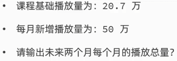
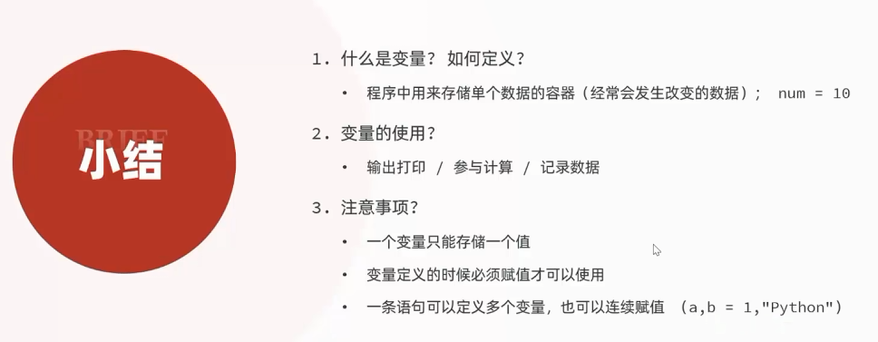

# 10 变量
存储单个数据的容器（而不是数据），存容易变化的数据
定义格式： 变量名 = 变量的值；  num = 1114.1
                =：赋值，把右边的值赋给左边变量
python是动态类型语言，运行时才类型检查，类型在运行时可以改变（一个变量可以接收不同类型的值）
实际中只一种

案例
                            
vscode快速复制当前行：shift + Alt + ↓
## 小结
