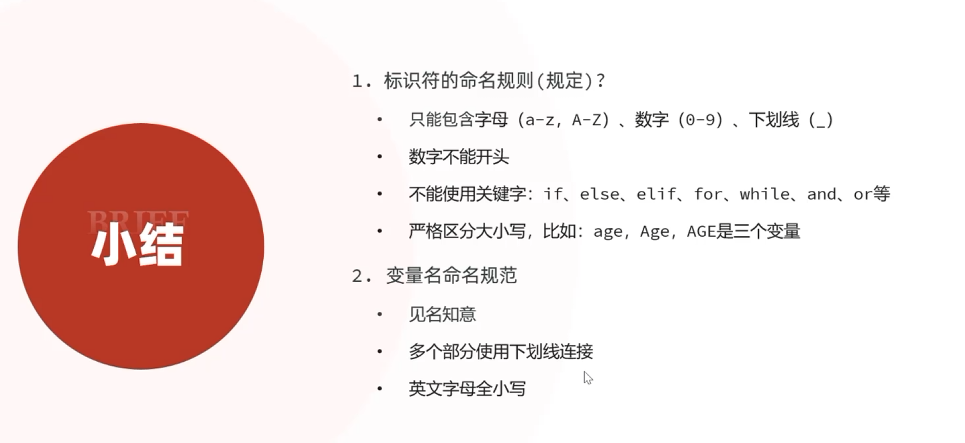

# 第11课：标识符、关键字与变量命名

> 原笔记：[11 标识符.md](<11 标识符.md>)；配套代码：[标识符.py](标识符.py)。  
> 本次整理日期：2026-11-13（北京时间）。历史资料补齐，原学习日期未确认。原始文件保留，新增解释属于补充。

> 排版调整：2026-11-14（北京时间）。以原笔记顺序为主线，图文和补充就近组织；沿用原有转写与验证记录，本次未修改原始材料或重新执行程序。

标识符： 程序员在代码中为变量、函数、类等元素所起的名字

### 补充：标识符是什么

标识符是代码中用来命名变量、函数、类等元素的名称。当前课先以变量名为例，如 `name6`。

## 命名规则

1. 只能包含字母、数字、下划线、
2. 不能以数字开头
3. 不能使用关键字（什么是关键字？）
    True, False, None, and, or, if, else, elif(是什么), for, while等
4. 严格区分大小写

### 补充：分清语法规则与命名习惯

| 项目 | 含义 | 示例 |
| --- | --- | --- |
| 语法规则 | 不满足就不能作为正常标识符使用 | 不能以数字开头，不能把关键字作为变量名 |
| 命名习惯 | 让合法名称更容易理解 | 变量名用小写字母，多个单词用下划线分开 |

入门时优先用英文字母、数字和下划线命名，首字符不能是数字，名称区分大小写。Python 也允许符合规则的部分 Unicode 字符，包括许多汉字；因此“只能使用英文字母”并非完整的语言限制。

| 写法 | 能否作为变量名 | 原因 |
| --- | --- | --- |
| `name6` | 可以 | 首字符不是数字 |
| `6name` | 不可以 | 数字开头 |
| `user_name` | 可以 | 用下划线分隔单词 |
| `user-name` | 不作为一个标识符 | `-` 会被理解为减号 |
| `True` | 不可以 | 是关键字 |
| `true` | 可以，但容易误导 | 与 `True` 不同，不能把它当作布尔常量使用 |

### 补充：关键字是什么

关键字是语言语法保留的词，不能随意拿来当变量名。例如：

- `True`、`False`、`None`：真假值与空值相关的保留写法。
- `if`、`elif`、`else`：条件分支；`elif` 表示继续检查另一个条件，后续课程再展开。
- `for`、`while`：循环。
- `and`、`or`：逻辑运算。

**纠正：**原笔记中的 `Flase` 应写成 `False`。错误拼写不会自动获得布尔值或关键字的含义。

### 补充：配套代码与实际输出

当前真正执行的代码是：

```python
name6 = "python"
print(name6)
```

已运行原脚本验证，输出为：

```text
python
```

前面的 `True = 1`、`6name = "python"` 等错误示例都已加上 `#` 注释，所以不会阻止当前脚本运行。如果要试验语法错误，应一次只试一个独立示例；不要取消所有注释后期待其余代码继续执行。

### 补充：补充与自测

`print` 是内置函数名，不是关键字。语法上可以给它重新赋值，但这会遮蔽原本的函数，影响后续使用，命名时应避免。

自测：`user_name`、`UserName`、`2name` 哪些合法？  
答案：前两个合法，第三个不合法。普通变量通常更推荐 `user_name`；`UserName` 的大小写形式并不导致语法错误。

### 补充：英文命名、语句与效率专项检查

- **英文命名：**name6 没有拼错，正在展示数字可以出现在名称后面，保留有教学意义。若改为真实业务描述，language_name 更准确表示“语言名称”。注释中的 true 不应自动改成 True，因为它是在展示普通名称与关键字的区别。
- **语句表达：**当前两行可执行代码简洁明确；非法命名示例保持注释并注明原因即可。
- **效率：**没有值得专门优化的性能问题，更长或更短的变量名不代表运行速度更快。

## 命名规范（变量）   PEP8

1. 见名知意
2. 多个部分用下划线连接（蛇形命名法）
3. 英文字母全小写

### 补充：当前代码可优化的点

- **可读性改进：**`name6` 很适合说明“数字可以出现在后面”。如果要表达实际业务含义，可以另用 `language_name`，并保留 `name6` 作为命名规则示例。
- **练习说明：**为注释掉的代码标注“合法但易混淆”“非法：关键字”“非法：数字开头”，比只写报错文字更容易复习。
- 目前可执行代码正确且足够简单，不必增加函数或其他结构。原代码未修改。

实际含义更明确的对照示例（保留 `name6` 作为原练习，本例未改写原文件）：

```python
language_name = "python"
print(language_name)
```

## 小结



**图片 `image.png` 的文字版：**

| 分类 | 图片中的规则或规范 |
| --- | --- |
| 命名规则 | 只能包含字母 `a-z`、`A-Z`，数字 `0-9` 和下划线 `_` |
| 命名规则 | 数字不能开头 |
| 命名规则 | 不能使用关键字，如 `if`、`else`、`elif`、`for`、`while`、`and`、`or` |
| 命名规则 | 严格区分大小写，`age`、`Age`、`AGE` 是不同名称 |
| 变量命名规范 | 见名知意 |
| 变量命名规范 | 多个部分用下划线连接 |
| 变量命名规范 | 英文字母全小写 |

**补充与纠正：**图片第一条使用了课程入门范围的简化说法；Python 还支持符合标识符规则的 Unicode 字符，前文已说明。`age`、`Age`、`AGE` 是三个不同名称，分别赋值后可作为三个不同变量使用，并不是仅写出名字就自动定义了变量。

## 附：完整源码备查（沿用原稿版本）

以下按原文件收录，包含注释掉的练习。带 `#` 的行不会执行；这些代码与前面的建议改写分开，原 `.py` 文件没有修改。

### 标识符.py

```python
# 标识符
# true = 1
# print(true)

# True = 1
# print(True)# 报错SyntaxError: cannot assign to True

# 6name = "python"
# print(6name) # 报错 SyntaxError: invalid decimal literal

name6 = "python"
print(name6)
```
