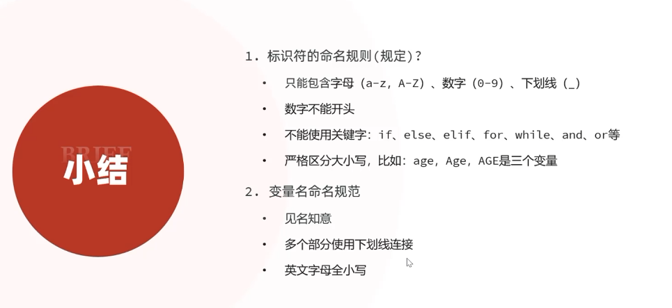

# 标识符
标识符： 程序员在代码中为变量、函数、类等元素所起的名字
## 命名规则
1. 只能包含字母、数字、下划线、
2. 不能以数字开头
3. 不能使用关键字（什么是关键字？）
    True, Flase, None, and, or, if, else, elif(是什么), for, while等
4. 严格区分大小写

## 命名规范（变量）   PEP8
1. 见名知意
2. 多个部分用下划线连接（蛇形命名法）
3. 英文字母全小写
## 小结

