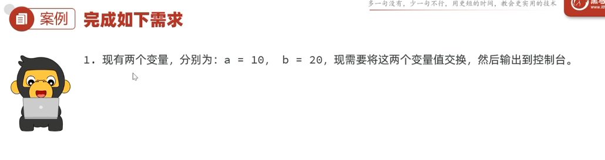
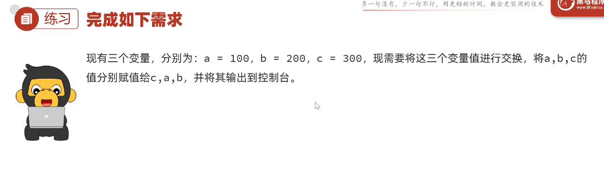

# 第12课：变量交换与三个变量轮换

> 原笔记：[12 变量案例（变量交换）.md](<12 变量案例（变量交换）.md>)；配套代码：[12 变量案例（变量交换）.py](<12 变量案例（变量交换）.py>)。  
> 本次整理日期：2026-11-14（北京时间）。历史资料补齐，原学习日期未确认。当前原笔记含“通过案例加深”以及两张题图引用；本文结合现有代码与题图解释，不把新增讲解视为原笔记已有内容。

> 排版调整：2026-11-14（北京时间）。以原笔记顺序为主线，图文和补充就近组织；沿用原有转写与验证记录，本次未修改原始材料或重新执行程序。

通过案例加深

### 补充：本课目标

- 理解顺序赋值为什么可能覆盖后续仍需要的旧值。
- 使用临时变量交换两个值，或轮换三个变量的值。
- 看懂更简洁的多目标赋值形式，并分清值移动的方向。



**图片 `image.png` 的文字版：**现有两个变量，分别为 `a = 10`、`b = 20`，需要交换这两个变量的值，然后输出到控制台。

原脚本的练习1已被注释，使用的思路是：

```python
a = 10
b = 20
temp = a
a = b
b = temp
```

| 执行步骤 | `a` | `b` | `temp` |
| --- | --- | --- | --- |
| 初始赋值后 | 10 | 20 | 尚未定义 |
| `temp = a` | 10 | 20 | 10 |
| `a = b` | 20 | 20 | 10 |
| `b = temp` | 20 | 10 | 10 |

`temp` 保存了旧的 `a`。如果只写 `a = b`，再写 `b = a`，第二行读到的是已经更新后的 `a`，两个名称最终都会对应原来的 `b`。



**图片 `image-1.png` 的文字版：**现有三个变量，分别为 `a = 100`、`b = 200`、`c = 300`，需要交换它们的值：将旧 `a`、旧 `b`、旧 `c` 的值分别赋给 `c`、`a`、`b`，并输出到控制台。这里补上“旧”字以明确赋值前后的对应关系。

初始值是 `a = 100`、`b = 200`、`c = 300`，随后执行：

```python
temp = a
a = b
b = c
c = temp
```

| 执行步骤 | `a` | `b` | `c` | `temp` |
| --- | --- | --- | --- | --- |
| 初始赋值后 | 100 | 200 | 300 | 尚未定义 |
| `temp = a` | 100 | 200 | 300 | 100 |
| `a = b` | 200 | 200 | 300 | 100 |
| `b = c` | 200 | 300 | 300 | 100 |
| `c = temp` | 200 | 300 | 100 | 100 |

值的移动方向是：**旧 `a` → 新 `c`，旧 `b` → 新 `a`，旧 `c` → 新 `b`**。这与原代码注释中“把 `a, b, c` 的值赋给 `c, a, b`”一致。

已运行原脚本验证，输出为：

```text
交换前：a = 100 b = 200 c = 300
交换后：a = 200 b = 300 c = 100
```

### 补充：两个变量交换

原笔记引用的同文件夹题目图片：

### 补充：Python 的简洁写法

两个变量交换可以写成：

```python
a, b = b, a
```

当前三个变量的轮换可以写成：

```python
a, b, c = b, c, a
```

理解方式：先计算右边表达式的结果，再把它们依次赋给左侧名称，因此不会因为左侧先更新一个名称而丢失右侧已经取得的旧值。这里只讨论普通变量的一一对应赋值。

### 补充：当前代码可优化的点

- **可读性改进：**写成 `print(...)`，去掉函数名和左括号之间的空格；`print (...)` 在这里能运行，但不是推荐的排版。
- **同阶段补充：**掌握临时变量过程后，可以用 `a, b, c = b, c, a` 表达同一轮换。临时变量版本适合观察执行过程，保留作对照有学习价值。
- **注释更清楚：**把轮换目标写成“旧 `a` 给 `c`、旧 `b` 给 `a`、旧 `c` 给 `b`”，减少只看字母顺序时的歧义。
- 现有轮换逻辑正确，没有需要修复的功能错误。以上均为建议，原始代码未修改。

### 补充：易错点与自测

- 赋值是按顺序执行的，后面的表达式会读取当时的值。
- 对照轮换时，必须区分旧值和新值，不能只记住“换位置”。
- `a, b, c = c, a, b` 表示相反方向的轮换，并不是当前代码的等价改写。

自测：初始 `a = 1`、`b = 2`、`c = 3`，执行当前轮换后是什么？  
答案：`a = 2`、`b = 3`、`c = 1`。

### 补充：英文命名、语句与效率专项检查

- **英文命名：**a、b、c 是本课约定的数学式示例名；temp 是 temporary（临时）的常见缩写，含义与用途匹配，无需强行改名。
- **语句表达：**可以用前文的多目标赋值简化轮换，但临时变量版本更方便观察每一步。去掉 print 和左括号之间的空格属于排版改进。
- **效率：**两种轮换都只处理固定数量的值；本次未测性能，不能仅因写成一行就说有明显提速。优先保证方向正确、容易理解。

## 附：完整源码备查（沿用原稿版本）

以下按原文件收录，包含注释掉的练习。带 `#` 的行不会执行；这些代码与前面的建议改写分开，原 `.py` 文件没有修改。

### 12 变量案例（变量交换）.py

```python
# # 练习1
# a = 10
# b = 20
# print("交换前：a =", a, "b =", b)
# temp = a
# a = b
# b = temp
# print("交换后：a =", a, "b =", b)


# 练习2 a, b, c赋值给c, a, b,并输出

a = 100
b = 200
c = 300
print ("交换前：a =", a, "b =", b, "c =", c)

temp = a

a = b
b = c
c = temp

print ("交换后：a =", a, "b =", b, "c =", c)
```
