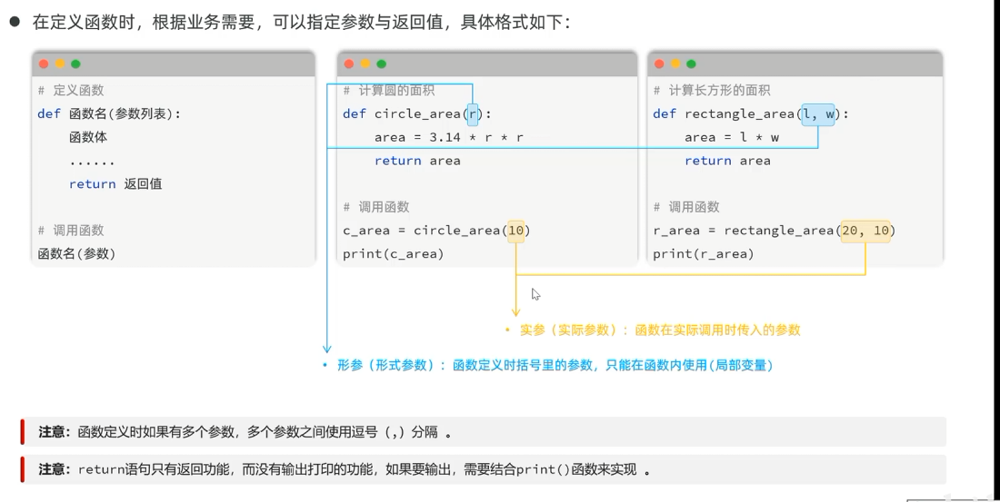
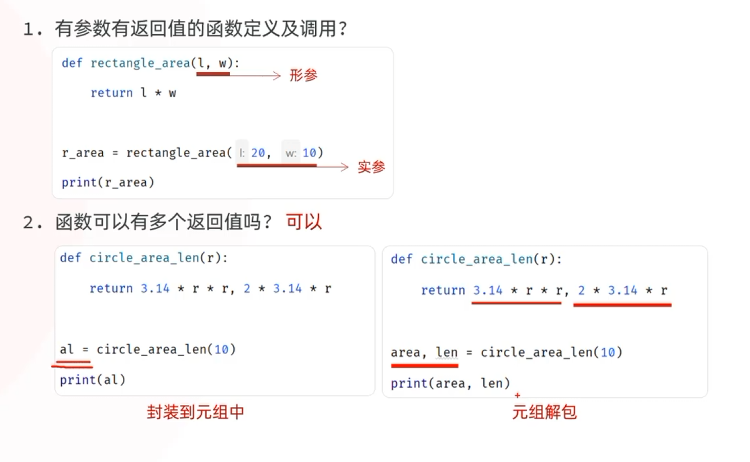

# 59 函数参数与返回值
return之后的代码不会运行


## 小结

### round() 函数

`round()` 是内置函数，用于对数值进行舍入，无需导入。

基本语法：`round(数字, 小数位数)`。

- 第一个参数：需要处理的数字。
- 第二个参数：保留的小数位数，可以省略。
- 返回值：舍入后的数值，不会修改原变量；省略第二个参数时返回整数。

```python
number = 3.14159
result = round(number, 2)

print(result)       # 3.14
print(number)       # 3.14159，原变量不变
print(round(3.6))   # 4
print(round(3.6, 0))  # 4.0
```

**易错点：**

- 恰好处于两个候选值中间时，选择偶数方向，例如 `round(2.5)` 得到 `2`，`round(3.5)` 得到 `4`。
- 浮点数存在表示误差，例如 `round(2.675, 2)` 得到 `2.67`。
- `round()` 不负责补齐末尾的零。固定显示两位小数应使用 `f"{数字:.2f}"`，例如 `round(85.0, 2)` 是 `85.0`，而 `f"{85.0:.2f}"` 是 `"85.00"`。