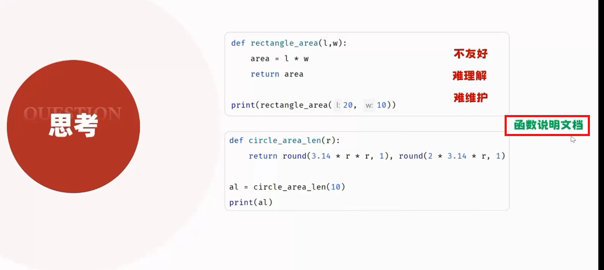
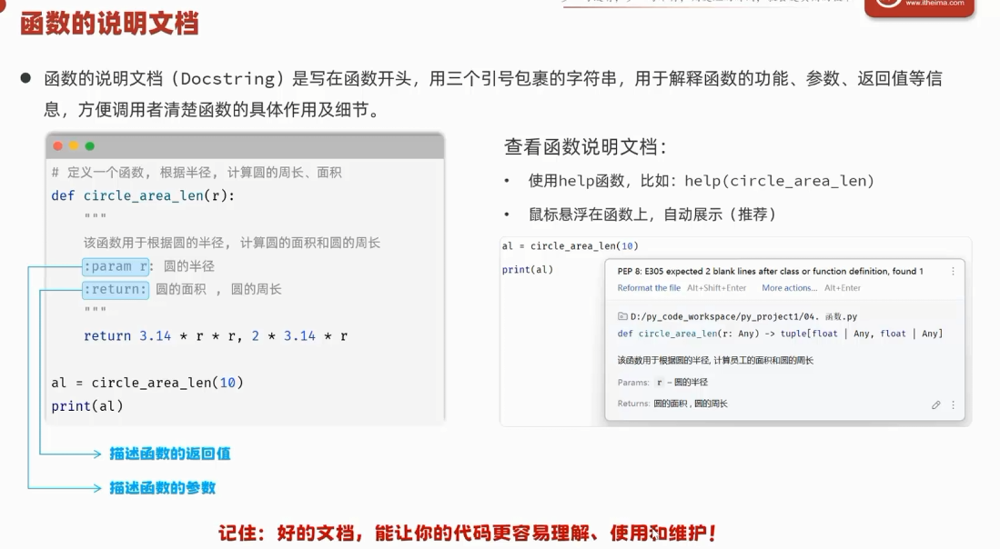

# 60 函数说明文档：优化版

整理日期：2026-11-23（北京时间）。来源：[原笔记](<60 函数说明文档.md>)、[原始代码](<60 函数说明文档.py>)和下列两张原图。本轮有该课节的实际问答记录；不据此认定其他课节已经学完。原始文件保留，本文按本轮最后读取的代码快照解释。

## 原图 1：为什么需要说明文档



图片文字版（来源：`image.png`）：截图用“**不友好、难理解、难维护**”说明缺少文档的问题，并给出两个案例：

```python
def rectangle_area(l, w):
    area = l * w
    return area

print(rectangle_area(20, 10))


def circle_area_len(r):
    return round(3.14 * r * r, 1), round(2 * 3.14 * r, 1)

al = circle_area_len(10)
print(al)
```

图片里调用位置的 `l:`、`w:` 是 IDE 参数提示，不是位置参数调用时必须照抄的文字。上述转写使用正常的位置参数语法。

长方形案例输入长和宽，先相乘，再返回面积；`20 × 10` 的结果是 `200`。圆的案例输入半径，按课内近似值 `3.14` 计算面积和周长，分别舍入到一位小数，再把两个返回值组合成元组；半径为 `10` 时是 `(314.0, 62.8)`。这些数值已运行核对。

就近命名建议：`l`、`w`、`r` 是可以保留的几何教学缩写；`al` 表达较含糊，保存完整返回值时可用 `area_and_perimeter`（面积和周长）。改名只改善可读性，不代表性能提升。

## 原图 2：说明文档的结构与查看方法



图片文字版（来源：`image-1.png`）：说明文档 Docstring 用三引号包裹，位于函数体开头，用来解释函数的功能、参数和返回值，帮助调用者理解函数。查看方式为 `help(circle_area_len)`，或在编辑器中将鼠标悬停在函数名上。图中强调：好的文档能让代码更容易理解、使用和维护。

图片代码转写：

```python
def circle_area_len(r):
    """
    该函数用于根据圆的半径，计算圆的面积和圆的周长
    :param r: 圆的半径
    :return: 圆的面积，圆的周长
    """
    return 3.14 * r * r, 2 * 3.14 * r

al = circle_area_len(10)
print(al)
```

**纠正旧稿的误读：** 本次实际重开图片放大核对，图中`:return:`已经是“圆的面积，圆的周长”，与return代码一致。图上方注释按“周长、面积”列举，不决定返回值位置。前稿将`:return:`说成写反不准确，此处纠正；解包仍按代码先面积、后周长。

**补充（参考课程资料）：** Docstring 必须是函数体的第一条语句；三引号字符串放在函数其他语句后面，不会自动成为该函数的 `__doc__`。`:param r:`、`:return:` 是说明文档的书写约定，不会验证输入或替你执行 `return`。三引号模板能否自动生成取决于编辑器和插件，不是 Python 自动补全的保证。

`help(函数名)` 查看函数对象的说明；`help(函数名(...))` 会先执行函数，再查看其返回值的帮助，两者行为不同。

## 此前排查记录：__doc__ 有中文，help 却漏掉一句

用户当前使用的解释器为 `D:\apps\wingw\ucrt64\bin\python.exe`，实际版本是 **Python 3.12.9（GCC UCRT 14.2.0）**。它与之前助手验证使用的 Python 3.13.9 不同，不能用之前的结果替代当前环境的核对。

本轮验证链：

1. 读取真实脚本并单独提取 `rectangle_area` 定义，`__doc__`、`inspect.getdoc()`、`pydoc.getdoc()` 和生成的纯文本中都含完整中文摘要。
2. 将完整帮助文本交给 Windows `more.com` 显示时，复现了摘要那一行消失、参数行仍在的现象。
3. 将帮助文本直接写到标准输出，摘要恢复；测试中把分页器设为“一旦调用就报错”，直接输出仍成功，确认绕开了分页器。

因此，本轮已定位到 **帮助文档的分页显示环节**，不是函数计算逻辑错误，也不是文档字符串没保存。此前“可能运行旧版本”的推测被这次证据排除。检查期间原文件新增了摘要后的空行、圆函数的说明和帮助调用；本笔记采用最后读取快照，没有覆盖这些用户修改。

**工作区修复与后续纠正（2026-11-23）：** 不要求每个函数替换 `help()`。最初仅把设置写进[文件夹 `.vscode/settings.json`](<../../../../../../.vscode/settings.json>)，用户随后提供的输出证明当次运行仍然丢行，不能称为当前终端已修复。进一步核对发现，VS Code 打开的是“无标题工作区”，对应 `C:/Users/WU/AppData/Roaming/Code/Workspaces/1784397218375/workspace.json`；窗口级配置应放在该工作区的 `settings`，而不是仅依赖文件夹配置。现已备份原配置，并将以下设置合并到真正的工作区 `settings` 中，写入后重新读取核对一致：

```json
{
    "commentTranslate.hover.content": false,
    "terminal.integrated.env.windows": {
        "PAGER": "type",
        "MANPAGER": "type"
    }
}
```

- `PAGER`、`MANPAGER` 告诉 `pydoc` 使用 Windows 内置 `type` 输出文本，替代发生丢行的 `more.com`。这只配置本工作区的新 Windows 终端，不修改系统环境或 Python 安装。帮助文本会一次输出，不再交互式分页；长文档可以在终端回滚查看。
- `MANPAGER` 的优先级高于 `PAGER`，两者一起设置，避免其中之一覆盖本次选择。
- 已在实际 MinGW/UCRT Python 3.12.9 和 Anaconda Python 3.13.9 中强制走终端分页路径，验证普通 `help(rectangle_area)` 与 `help(circle_area_len)` 的中文摘要、参数、返回说明全部保留。测试不是通过修改函数来通过。
- 生效步骤：保存正在编辑的文件，执行命令面板 **Developer: Reload Window（开发人员：重新加载窗口）**，关闭原有终端后新建终端，再运行原脚本。已有终端不会自动获得新的环境变量。
- 对用户当前已打开的 PowerShell，可直接设置下面两个变量后再次运行，避开“旧终端未获得新环境”的不确定性：

```powershell
$env:PAGER = "type"
$env:MANPAGER = "type"
```

- 可用 `& 'D:\apps\wingw\ucrt64\bin\python.exe' -c 'import os; print(os.getenv("PAGER")); print(os.getenv("MANPAGER"))'` 核对实际子进程收到的值，预期两行都是 `type`。这是给用户当前终端的验证步骤，尚未取得该终端的实际结果。
- 原无标题工作区配置备份为 [备份文件](<../../../../../../.vscode/backups/workspace-1784397218375-bb66e0cbdbd2.json>)；合并只增加终端显示和悬浮处理设置，保留文件夹列表与其他设置。文件夹配置仍保留，供直接“打开文件夹”方式使用。
- 修复条件、子进程验证与用户终端结果必须分开记录：之前强制设置变量的子进程测试通过，不等于 VS Code 当时已经给现有终端注入这些值。
- 之前的界面读取超时，未取得修改后的悬浮截图；不能把配置已保存说成界面已确认修复。

**临时备用方法：** 如果暂时不能新建终端，可在函数定义后，将需要正常显示的 `help(rectangle_area)` 换为：

```python
import pydoc
import sys

pydoc.doc(rectangle_area, title="Help on %s:", output=sys.stdout)
```

`import` 导入标准库，`sys.stdout` 表示标准输出；`output=sys.stdout` 让 `pydoc` 直接写出帮助文本，绕开分页程序。正常环境下 `help(rectangle_area)` 原写法依然正确；这里是在处理本机显示兼容问题，不需要重装 Python或修改系统编码。只想看原始文档时，`print(rectangle_area.__doc__)` 也可用。

实际验证输出包含：

```text
Help on function rectangle_area in module __main__:

rectangle_area(l, w)
    根据长方形的长度和宽度,计算长方形的面积

    :param l:长度
    :param w:宽度
    :return :长方形的面积
```

## 当前本地练习：完整源码与检查

下面是本轮最后读取的原始代码，不替用户改写。脚本会先输出圆面积，再打印排查信息和函数帮助，之后计算长方形面积，最后展示多返回值及解包。

```python
# 函数的参数与返回值

# 函数1：计算圆的面积 -- 半径
def circle_area(r):
    area = 3.14 * r ** 2
    return area

area = circle_area(10)
print(area)


# 函数2：计算长方形的面积 -- 长、宽
def rectangle_area(l, w):
    """
    根据长方形的长度和宽度,计算长方形的面积

    :param l: 长度
    :param w: 宽度
    :return: 长方形的面积

    """
    area = l * w
    return area

# 查看函数功能
print(rectangle_area.__doc__)              # 当前函数实际保存的文档说明
print(rectangle_area.__code__.co_filename) # 当前函数定义所在的文件
help(rectangle_area)
help(rectangle_area)


print(rectangle_area(l=20, w=10))

# 函数3：计算圆的面积、周长 -- 半径 ---> 如果返回值有多个，多个返回值之间逗号分隔 ---> 多个返回值会封装到元组之中
def circle_area_len(r):
    """
    根据圆的半径，计算圆的面积和周长

    :param r: 半径
    :return: 圆的面积，圆的周长
    """
    return round(3.14 * r * r, 1), round(2 * 3.14 * r, 1)

help(circle_area_len)

al = circle_area_len(10)
print(al)
print(type(al))


area, len = circle_area_len(10)  # 解包
print(area)
print(len)
```

`circle_area(10)` 输出 `314.0`；`rectangle_area(l=20, w=10)` 输出 `200`；圆面积与周长的元组为 `(314.0, 62.8)`，类型为 `<class 'tuple'>`，解包后依次打印 `314.0`、`62.8`。原来的两次 `help(rectangle_area)` 会打印两次帮助，是代码明确调用两次的结果。

| 位置 | 原写法 | 建议写法 | 原因与行为差异 |
| --- | --- | --- | --- |
| 原脚本第 47 行 | `al` | `area_and_perimeter` | 原名合法但含义不够清楚；新名表示“面积和周长”，不改变数值输出。 |
| 原脚本第 52 行 | `area, len = circle_area_len(10)` | `area, perimeter = circle_area_len(10)` | `perimeter` 表示“周长”；原来的 `len` 会遮蔽内置 `len()`，虽不影响本次打印，但后续再调用 `len(...)` 就可能报错。 |
| 原脚本两次 `help(rectangle_area)` | 重复帮助及排查日志 | 保留一次普通 `help()` | 改变输出次数、移除定位日志；工作区终端配置负责显示兼容，原脚本不改。 |

`rectangle_area`、`circle_area` 拼写与含义正确；`circle_area_len` 的 `len` 是函数名的一部分，不会遮蔽内置函数，可以保留教学名称。`area`、`r`、`l`、`w` 没有发现必须修改的问题。注释标题“函数的参数与返回值”可改为本课“函数说明文档”，但不影响执行。

配套[Python 优化版](<60 函数说明文档-优化版.py>)在上述改写附近保留中文说明；添加函数说明并纠正返回顺序，保留课内 `3.14`、`round(..., 1)` 和两次圆函数调用所表达的元组、解包教学步骤。没有引入必须使用 `math.pi` 的新要求。当前练习没有值得专门优化的性能问题，本次不声称改名或省掉日志让计算更快。

## 新截图：编辑器悬浮提示为什么与教程不同

这与终端的 `help()` 分页是不同环节。截图中教程用 **PyCharm**，用户使用 **VS Code + Pylance**；`Parameters`、`Returns`、`out` 等展示方式、中文标签与类型推断样式不同，本身不表示代码错误。`out` 是悬浮面板的返回值标签，不是要求新增的变量。

本机已安装 `ms-python.vscode-pylance@2026.4.1`、`intellsmi.comment-translate@3.1.0`、`ninja.translator@0.1.5`。没有发现同时安装 Pyright 和 Pylance。实际读取 Comment Translate 的实现确认：它注册悬浮提供器，并调用 `vscode.executeHoverProvider` 取得其他扩展的悬浮内容再加工，因此是截图中重复签名／文档的明确排查对象；尚未通过最终界面截图做因果确认。

本次只将 `commentTranslate.hover.content` 设为 `false`，关闭对已有代码悬浮提示的二次加工。没有卸载翻译插件，也没有关闭其全部注释翻译功能。`ninja.translator` 的悬浮功能默认关闭，用户设置未开启；本次未改它。

**补充（参考课程资料）：** 文档字段按规范保留冒号后的空格，功能摘要与字段之间留空行。例如原脚本的 `:param l:长度` 可写为 `:param l: 长度`，`:return :长方形的面积` 可写为 `:return: 长方形的面积`。这是供 IDE 识别结构的文档格式改进，不改变函数运算，也不是修复 `more.com` 的方法。优化版已采用以下格式，原始 `.py` 不改；本批读取时原文档:param和:return空格已由用户规范，下面保留推荐格式作对照：

```python
def rectangle_area(l, w):
    """根据长方形的长度和宽度，计算长方形的面积。

    :param l: 长度。
    :param w: 宽度。
    :return: 长方形的面积。
    """
    return l * w
```

`Any` 表示没有明确的类型约束或无法进一步推断，与中文无关；没有给参数写类型注解时出现它是正常现象。本次不为模仿另一个 IDE 的外观而强改函数签名或解释器。

## 参考与补漏、验证边界

- 已实际读取[模块 10 教材](<../../../../../../参考资料/黑马Python-AI课程笔记/计算机/编程语言/黑马程序员-Python-AI/textbooks/模块10_函数基础：定义调用、参数返回值与嵌套调用_精读全书.md>)中 P60“函数说明文档”的结构、查看方式和课后练习，以及[复习笔记 06](<../../../../../../参考资料/黑马Python-AI课程笔记/计算机/编程语言/黑马程序员-Python-AI/notes/笔记06_函数体系与类型注解作用域传参机制与 lambda_笔记.md>)中“函数的说明文档”。据此补齐 Docstring 的位置、功能／参数／返回值、查看方式与 `help` 传参边界。没有把同册其他小节记成本课已学内容。
- 本机分页器问题以实际解释器、原脚本函数定义和逐步运行结果为依据。官方资料说明 [`help()` 使用 pydoc 并可能分页](https://docs.python.org/3.12/library/pydoc.html)；本轮具体丢行现象来自实测，不以历史编码问题单独证明。
- 原始课件第二张图的:return顺序本来与算式一致，本次已纠正旧稿误读。未核对课程视频或逐字稿，不声称核实讲师原话。
- Python 优化版恢复普通 `help()`，仅产生控制台输出，不读写业务数据。验证范围为函数计算、两套解释器的分页显示路径、配置 JSON 和扩展声明；不涵盖重载后真实 VS Code 悬浮画面或所有分页器版本。原始 `.md`、`.py` 和图片保留。
- 配置来源：[Comment Translate 项目](https://github.com/intellism/vscode-comment-translate)、[Pylance 的 reStructuredText 支持说明](https://github.com/microsoft/pylance-release#settings-and-customization)、[reStructuredText 字段列表规范](https://docutils.sourceforge.io/docs/ref/rst/restructuredtext.html#field-lists)。本轮实际重读了模块 10 与复习笔记 06 的对应说明文档段落，未核对视频。

工作区层级依据：[VS Code 多根工作区设置说明](https://code.visualstudio.com/docs/editing/workspaces/multi-root-workspaces#settings)；无标题工作区可以只有一个文件夹，仍应区分窗口工作区与文件夹设置。

## 本批同步与验证

本批截止快照：2026-11-23T15:54:33+08:00。本批重新打开两张原图，复核当前源码和已有Python优化版；当前原脚本的param／return格式已经规范，不能继续列作待修的当前问题。

此前终端／扩展排查按共享记录保留，本批没有重做more测试、修改配置或观察VS Code界面；用户当前终端最终效果仍未确认。受控捕获输出能够含摘要，不代表该终端分页链路已生效。


|原名|建议|含义|位置|原因|
|---|---|---|---|---|
|len、al|perimeter、area_and_perimeter|周长／结果元组|结果接收与解包|沿用已有优化版的有效命名改进|


## 参考与补漏

本次实际对照以下对应小节；资料为Video2Book二次整理，不把后续整册内容计作本课遗漏。具体补漏／纠正已经放在知识点附近。

- [模块10_函数基础：定义调用、参数返回值与嵌套调用_精读全书.md](<../../../../../../参考资料/黑马Python-AI课程笔记/计算机/编程语言/黑马程序员-Python-AI/textbooks/模块10_函数基础：定义调用、参数返回值与嵌套调用_精读全书.md>)：P60，本次实际读取的对应段落，476—559行。
- [笔记06_函数体系与类型注解作用域传参机制与 lambda_笔记.md](<../../../../../../参考资料/黑马Python-AI课程笔记/计算机/编程语言/黑马程序员-Python-AI/notes/笔记06_函数体系与类型注解作用域传参机制与 lambda_笔记.md>)：115—156行，对应复习小节。

原始材料与参考资料保持只读；本稿新增示例的运行边界见代码检查。
