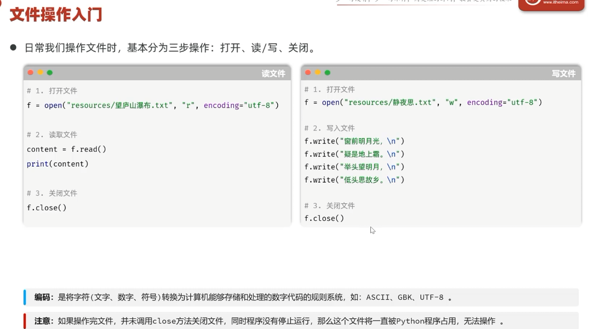

# 110 文件操作入门

整理日期（北京时间）**2026-11-27**。对应课节 P110「会话管理：文件操作入门」。

学习材料包括 [原笔记](<110 文件操作入门.md>)、[原练习](<110 文件操作入门.py>)、[诗文](望庐山瀑布.txt) 和 [课程配图](image.png)。可以直接运行 [Python 优化版](<110 文件操作入门-优化版.py>)。

## 文件操作的三个步骤



上图来自本课目录的 `image.png`。课件把读写文件分成三步，先打开文件，再读取或写入，最后关闭文件。

| 步骤 | 读文件 | 写文件 |
| --- | --- | --- |
| 打开 | `open("resources/望庐山瀑布.txt", "r", encoding="utf-8")` | `open("resources/静夜思.txt", "w", encoding="utf-8")` |
| 读写 | `content = f.read()`，随后 `print(content)` | `f.write(...)`，每句末尾用 `\n` 换行 |
| 关闭 | `f.close()` | `f.close()` |

课件读文件的代码如下。原练习把诗文直接放在脚本旁，因此它的路径中没有 `resources/` 这一层。

```python
f = open("resources/望庐山瀑布.txt", "r", encoding="utf-8")
content = f.read()
print(content)
f.close()
```

课件写文件的代码如下。这段示例涉及写入，阅读时注意 `w` 会清空同名文件的旧内容。

```python
f = open("resources/静夜思.txt", "w", encoding="utf-8")
f.write("窗前明月光，\n")
f.write("疑是地上霜。\n")
f.write("举头望明月，\n")
f.write("低头思故乡。\n")
f.close()
```

图中还介绍了 ASCII、GBK、UTF-8 等编码，并提醒用完记得关闭文件。**补充（参考课程资料）**。文本模式下，`encoding="utf-8"` 告诉 Python 如何把磁盘里的字节解码成字符串。`read()` 将所有剩余内容读成一个 `str`。较大的文本可按行迭代，降低一次性读取的内存开销。

**纠正**。关闭文件会释放文件资源。文件打开时对其他程序读写、重命名的影响取决于操作系统和打开时的共享方式。

## 原练习与报错

原练习的输入是本课目录中的 `望庐山瀑布.txt`，输出是终端里的诗文。下面是本次读取到的原始代码。

```python
# 读文件
# 1.打开文件
f= open("./望庐山瀑布.txt", "r",  encoding="utf-8" )

# 2.读取文件内容
content = f.read()# 读取所有内容
print(content)

# 3.关闭文件
f.close()
```

### 错误修复一 · 以脚本位置定位诗文

第 3 行使用 `"./望庐山瀑布.txt"`。你的 PowerShell 提示符是 `PS D:\专业技能>`，此时启动的 Python 进程会从 `D:\专业技能` 查找该相对路径。我从该目录运行原练习，复现了 `FileNotFoundError`。文件实际在「110 文件操作入门」目录。

**纠正**。教材里提到相对于脚本或项目目录的写法。对于直接交给 `open()` 的相对路径，基准是**进程的当前工作目录**。`Path.cwd()` 能显示这个目录。在常规脚本中，`__file__` 给出当前脚本的路径，`.resolve().parent` 取得脚本所在目录，`/` 用来拼接路径。C 的 `fopen("./…", "r")` 也按进程工作目录解析相对路径。

```python
from pathlib import Path

poem_path = Path(__file__).resolve().parent / "望庐山瀑布.txt"
f = open(poem_path, "r", encoding="utf-8")
```

### 错误修复二 · 关闭打开的文件对象

你贴出的版本第 10 行写的是 `close()`。Python 会把它当成独立函数查找。找不到这个名字时会抛出 `NameError`。本地最新版已改为 **`f.close()`**，这正是本课截图和 P110 逐字稿中的写法。

### 前瞻优化 · 自动关闭文件

`with open(...) as poem_file:` 把打开的文件对象绑定给 `poem_file`。执行离开缩进块时，Python 会关闭文件，块内读取抛出异常时也会关闭。读出的 `content` 是普通字符串，可以在块外打印。这里把 `f` 改成 `poem_file`，方便看出变量指的是诗文文件对象，适合之后同时处理多个文件的代码。短练习中 `f` 也是常见合法写法。`content` 与实际内容相符，可保留。

```python
"""原练习：110 文件操作入门.py
配套说明：110 文件操作入门-优化版.md
"""

from pathlib import Path

# 原来的 "./望庐山瀑布.txt" 从终端工作目录查找。
# __file__ 指向本脚本，resolve().parent 取得脚本所在目录。
poem_path = Path(__file__).resolve().parent / "望庐山瀑布.txt"

# 原练习在末尾调用 f.close()。直接写 close() 会查找同名函数。
# with 会在离开缩进块时关闭文件，读取发生异常时也会关闭。
with open(poem_path, "r", encoding="utf-8") as poem_file:
    content = poem_file.read()

# content 已经读成字符串，关闭文件后仍可以输出。
print(content)
```

**实际运行输出**。优化版从工作区根目录和课节目录启动时均读取了同一份诗文。

```text
望庐山瀑布(李白)

日照香炉生紫烟，
遥看瀑布挂前川，
飞流直下三千尺，
疑是银河落九天。
```

诗文很短，直接使用 `read()` 就足够。优化的收益在于定位文件和关闭资源的可靠性，未做速度比较。

## 参考与补漏

- [模块 19 教材](../../../../../../../%E5%8F%82%E8%80%83%E8%B5%84%E6%96%99/%E9%BB%91%E9%A9%ACPython-AI%E8%AF%BE%E7%A8%8B%E7%AC%94%E8%AE%B0/%E8%AE%A1%E7%AE%97%E6%9C%BA/%E7%BC%96%E7%A8%8B%E8%AF%AD%E8%A8%80/%E9%BB%91%E9%A9%AC%E7%A8%8B%E5%BA%8F%E5%91%98-Python-AI/textbooks/%E6%A8%A1%E5%9D%9719_AI%E5%BA%94%E7%94%A8%EF%BC%9A%E4%BC%9A%E8%AF%9D%E7%8A%B6%E6%80%81%E7%AE%A1%E7%90%86%E4%B8%8E%E6%96%87%E4%BB%B6%E6%8C%81%E4%B9%85%E5%8C%96_%E7%B2%BE%E8%AF%BB%E5%85%A8%E4%B9%A6.md)「文件操作函数与模式参数」「文本内容读取与空行排查」。核对了 `r`、`w` 和 UTF-8。另查阅了后续「上下文管理器语法与最佳实践」。
- [复习笔记 11](../../../../../../../%E5%8F%82%E8%80%83%E8%B5%84%E6%96%99/%E9%BB%91%E9%A9%ACPython-AI%E8%AF%BE%E7%A8%8B%E7%AC%94%E8%AE%B0/%E8%AE%A1%E7%AE%97%E6%9C%BA/%E7%BC%96%E7%A8%8B%E8%AF%AD%E8%A8%80/%E9%BB%91%E9%A9%AC%E7%A8%8B%E5%BA%8F%E5%91%98-Python-AI/notes/%E7%AC%94%E8%AE%B011_AI%E5%BA%94%E7%94%A8%E4%BC%9A%E8%AF%9D%E7%8A%B6%E6%80%81%E7%AE%A1%E7%90%86%E4%B8%8E%E6%96%87%E4%BB%B6%E6%8C%81%E4%B9%85%E5%8C%96_%E7%AC%94%E8%AE%B0.md)「文件访问模式」「字符编码标准与文本读写」。核对了 `read()` 返回字符串和 `w` 会截断已有文件。
- [P110–P112 逐字稿](../../../../../../../%E5%8F%82%E8%80%83%E8%B5%84%E6%96%99/%E9%BB%91%E9%A9%ACPython-AI%E8%AF%BE%E7%A8%8B%E7%AC%94%E8%AE%B0/%E8%AE%A1%E7%AE%97%E6%9C%BA/%E7%BC%96%E7%A8%8B%E8%AF%AD%E8%A8%80/%E9%BB%91%E9%A9%AC%E7%A8%8B%E5%BA%8F%E5%91%98-Python-AI/subtitles/BLK09_P110-P112_%E9%80%90%E5%AD%97%E7%A8%BF.md)的 P110 读文件示例。核对了读取顺序和 `f.close()`。自动关闭是后续资源释放内容。
